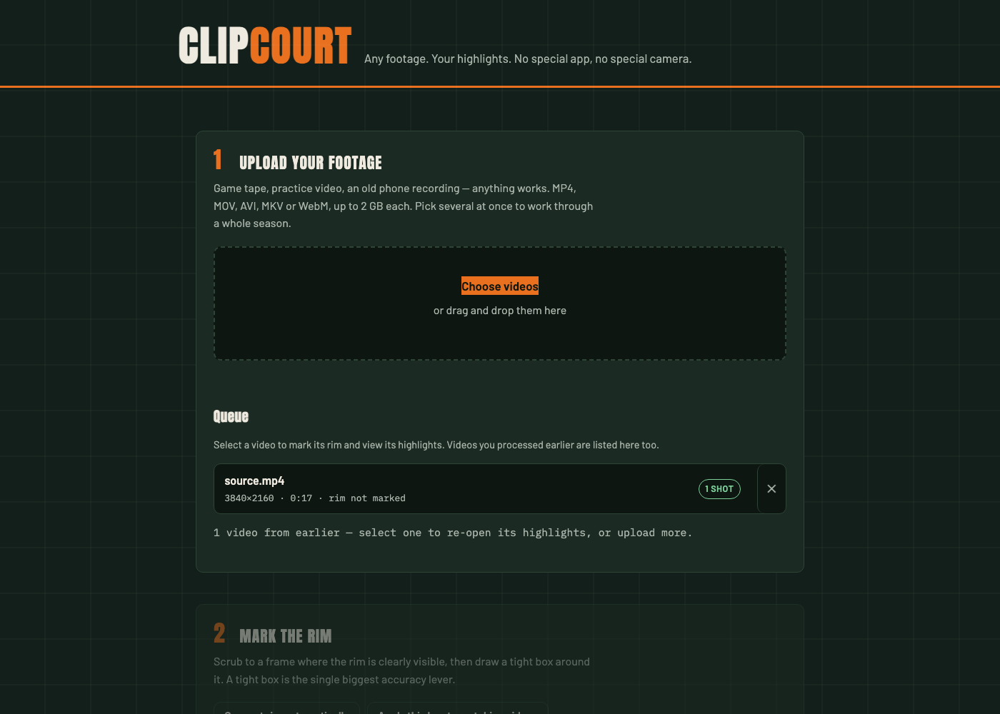

# 🏀 ClipCourt

[](https://github.com/Ishaan7497/ClipCourt/actions/workflows/tests.yml)


[](LICENSE)

Turn **any** basketball footage into highlight clips. Upload a video, draw one box around the rim in your browser, and get made/miss-classified clips back — with the original audio, cut frame-accurately.

The structural difference from apps like Hooper: nothing has to be recorded inside an app. Old camcorder tape, a parent's phone video, a league's tripod footage — if it plays, ClipCourt can process it.



## Quick start

```bash
pip install -r requirements.txt
uvicorn server:app --reload
# open http://127.0.0.1:8000
```

The first job downloads the YOLOv8s weights (~22 MB) automatically. `ffmpeg` on the PATH is strongly recommended — clips keep their audio and cut faster with it (there is a no-audio OpenCV fallback without it).

## How it works

```
browser                          server                         engine
─────────                        ──────                         ──────
upload video(s) ───────────────▶ POST /api/videos ────────────▶ probe + validate
scrub & draw rim box ──────────▶ GET  /videos/{id}/frame        extract JPEG frame
  (or auto-suggest it) ────────▶ GET  /videos/{id}/suggest-rim  colour+shape scan
"Find my highlights" ──────────▶ POST /api/jobs ──────────────▶ worker thread:
poll every second ─────────────▶ GET  /api/jobs/{id}              YOLO → BallTracker
                                                                  → HoopShotDetector
watch clips / download zip ────▶ GET  /jobs/{id}/clips[.zip] ◀─── ffmpeg clip pass
reopen an earlier session ─────▶ GET  /api/videos ◀──────────────  job/video sidecars
```

**Detection pipeline** (in `engine.py`):

1. **YOLO** finds sports-ball candidates each frame (low confidence threshold to catch the blurry ball at the rim; implausibly large boxes rejected).
2. **BallTracker** picks the candidate that best continues the trajectory (confidence minus distance penalty), EMA-smooths positions, and *coasts* through short occlusions with a velocity computed over the real frame gap.
3. **HoopShotDetector** arms when a descending ball enters the attempt zone, and calls **MADE** only if the ball was *measured* descending through the rim band before being seen below it — a front-of-rim brick that drops below rim level is a **MISS**. A cooldown suppresses rebound double-triggers, and direction is never inferred across a stale gap (`direction_gap_frames`).
4. **Clipping** merges overlapping shot windows and cuts each with a frame-accurate ffmpeg re-encode (audio preserved). No `cap.set()` keyframe drift in either path.

## Batch, speed and output

- **Queue several videos at once.** Pick or drop multiple files; they upload
  one at a time (parallel 2 GB uploads only starve each other) and land in a
  queue. Select any one to mark its rim or re-open its clips. *Run every
  marked video* starts them all — the worker pool decides how many run
  concurrently.
- **Rim auto-suggest.** *Suggest rim automatically* scans a handful of frames
  for something rim-shaped: wide, hollow and in the same place every frame
  (a basketball is the same colour but round, solid and moving). It is a
  starting point you confirm — when it isn't sure it says so instead of
  guessing.
- **Copy a rim box across videos.** *Apply this box to matching videos* copies
  the box to every queued video with the same frame size. Different frame
  sizes are skipped, since pixel coordinates wouldn't mean the same thing.
- **GPU acceleration.** Inference runs on CUDA or Apple MPS when available,
  CPU otherwise, and frames go through YOLO in batches so a GPU isn't idling
  between round trips. The device is named in the progress line and recorded
  on the finished job. Force one with `CLIPCOURT_DEVICE=cpu`.
- **Vertical 9:16 export.** Optionally cut a second copy of every clip,
  cropped around the ball for phones and social, alongside the full-frame one.
- **Sessions survive restarts.** Videos and jobs are written to JSON sidecars
  next to the footage and reloaded on boot, so finished clips, player tags and
  shot charts are still there after a reload — or after the server restarts.
  A job interrupted mid-run is restored as a failure you can re-run, not as a
  job that silently hangs forever.

## Coaching features

The results page doubles as a film-room dashboard:

- **Roster** — add/remove players per video (persisted to `data/videos/<id>/roster.json`); each player gets an auto-assigned color.
- **Shot chart** — every detected shot is plotted on a half-court diagram (green = made, red = miss, ring color = player). Locations are *approximate*: the ball's pixel position at shot resolution, scaled by the known 18-inch rim width — a single fixed camera can't triangulate true court position.
- **Tagging** — assign a player and a drill type (Layups / 3-Pointers / Mid-range) to each shot from its clip card; assignments persist to `coaching.json` next to the clips. A drill filter narrows the chart and clip grid.
- **Stats** — live per-player cards (FG%, made/missed, close/mid/deep splits) plus a team total.
- **Export** — `export.csv` (player, result, time, location, confidence, drill) and `export.pdf` (court chart + stats tables via matplotlib/reportlab).

## Accessibility

- Full keyboard flow, including rim marking on the canvas (arrows move, Shift+arrows resize, Delete clears, Alt for 1-px nudge) plus plain numeric x/y/w/h fields as an equivalent.
- Live regions announce upload status, rim-box changes, progress, and each detected shot.
- Visible focus rings, WCAG-AA contrast on the dark theme, `prefers-reduced-motion` respected, semantic landmarks and a skip link.

## Honest limits

Made/miss classification from a single 2D camera angle has an accuracy ceiling — a ball passing just in front of the rim can look identical to one passing through it. Every shot event carries a `confidence` field (`high` when the through-the-rim descent was directly measured, `medium` when resolved on timeout or after occlusion) so users know which calls to double-check. Tighter rim boxes and steadier camera positions measurably help.

## Tests

```bash
python -m pytest tests/ -q
# or run a file directly, no pytest required:
python tests/test_detector.py
python tests/test_export.py
python tests/test_server.py
```

No video fixtures, no YOLO weights, no network, and no test-only dependencies
— each file also runs standalone with a plain `python`.

| File | Covers |
|---|---|
| `test_detector.py` | Synthetic trajectories: clean swish, front-rim brick, occluded swish, velocity across detection gaps and after coasting, re-acquiring a lost track, rebound cooldown, 9:16 crop geometry, rim-vs-ball shape scoring, device resolution, cancelling a clip pass. |
| `test_export.py` | CSV rows and escaping, per-player/team stat tallies, removed-player fallbacks, real PDF generation including a video name that looks like markup (skips cleanly if matplotlib/reportlab are absent). |
| `test_server.py` | Persistence round-trip and restart recovery, legacy-directory adoption, corrupt- and malformed-sidecar tolerance, deleting or cancelling a job mid-run, roster CRUD, shot-tagging guards (409/404/422), status polls leaving job records untouched, clip-length guard, clip-path traversal rejection, export guards, zip contents, rim suggestion on a generated video. |

## Tuning

All knobs live in `EngineConfig` (`engine.py`). The sensitive ones:

| Parameter | Default | Notes |
|---|---|---|
| `max_jump_ratio` | 0.18 | Max ball movement per frame as a fraction of frame width. Lower for tripod footage, raise for handheld/zoomed footage. |
| `yolo_conf` | 0.15 | Raise if random objects get tracked; lower if the ball vanishes near the rim. |
| `coast_frames` | 6 | How long to predict through occlusion. Coasted points never count toward a make. |
| `shot_cooldown_seconds` | 2.0 | Raise if rebounds double-trigger. |
| `device` | auto | `cuda`, `mps` or `cpu`. Auto-detected; `CLIPCOURT_DEVICE` overrides it for a whole process. |
| `batch_frames` | auto | Frames per inference call — 8 on a GPU, 1 on CPU. Lower it if a GPU runs out of memory on 4K footage. |
| `vertical_reframe` | False | Also cut a 9:16 copy of every clip, cropped around the ball. |

## Deploying

The engine is fully headless (no GUI, no `input()`, no display probing). Job
and video state is kept in memory *and* mirrored to JSON sidecars under
`data/videos/`, which is enough to survive a restart but still assumes a
single process — for multi-process workers, move the registry to Redis or a
database. Otherwise: put uvicorn behind nginx with a matching
`client_max_body_size`, and add periodic cleanup of `data/videos/`.

`data/` is gitignored, as are the model weights — don't commit footage.

## Roadmap

- [x] Batch queue UI (process a whole season of games)
- [x] Auto-suggest the rim box with manual confirm
- [x] Vertical/social reframe export
- [x] Per-session shot chart from event coordinates
- [ ] Multi-process job registry (Redis/DB) for horizontal scaling
- [ ] Auto-suggest a rim box per *camera angle* rather than per video

## License

[MIT](LICENSE)
